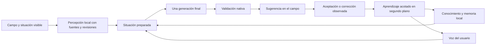

> Actualización de implementación: el usuario amplió el alcance a inteligencia de punta a punta. Captura de fuentes AX, biblioteca explícita y enriquecimiento del motor están implementados según [el alcance vigente](./mvp.md). Las capacidades visuales y aprendizaje automático duradero descritos aquí todavía no están construidos. Consulte el registro para distinguir código, paquete y prueba real.

# Autocomplete Everywhere — Inteligencia invisible: diseño integral de producto

**Propuesta del 4 de septiembre de 2026. No implementada.**

**Exploración de largo plazo, no alcance del MVP.** La [primera versión a validar](mvp.md) es el único alcance vigente. Biblioteca, importación, estilo y presets de esta exploración se retiraron de la maqueta de primera versión; requieren evidencia antes de volver a entrar.

**Identidad confirmada por el usuario:** este producto es el nuevo **Autocomplete Everywhere**. Autocomplete Everywhere fue el nombre de trabajo. La marca vigente de esta propuesta y de la experiencia es Autocomplete Everywhere; los nombres históricos de archivos, código y evidencia no constituyen otra marca de producto.

Este documento define la experiencia completa solicitada: comprender la tarea visible, usar conocimiento y memoria, aprender la voz del usuario y ayudar al instante, sin conectores de servicios. Los documentos de la capa actual describen una implementación más limitada. No deben usarse como techo de la visión ni como prueba de estas capacidades futuras.

## 1. Objetivo y decisiones

La persona sigue trabajando en sus aplicaciones. Autocomplete Everywhere mantiene preparada la información necesaria y ofrece el texto que permite avanzar, cuando la intención y la evidencia lo permiten. La experiencia debe ahorrar recordar, buscar, copiar, explicar y redactar. La cantidad de texto generado no mide ese ahorro.

Evalué tres formas de empaquetarlo:

| Forma | Ventaja | Coste para la experiencia |
|---|---|---|
| Asistente que se abre para conversar | Permite expresar objetivos complejos | Exige cambiar de lugar y explicar lo que está pasando |
| Autocomplete con un gran perfil global | Parece pequeño y fácil de construir | Mezcla hechos, pierde la fuente actual y carga demasiada información |
| Asistencia en el campo con contexto preparado y controles secundarios | Conserva el flujo y permite conocimiento personal | Exige resolver bien percepción, vigencia y oportunidad |

Recomiendo la tercera. Una interfaz pequeña requiere decisiones internas precisas. No significa que deba construirse un agente permanente con un ciclo abierto de herramientas.

Decisiones estables: un producto, generación Qwen 3.8 27B en Cerebras, resultado final, intervención nativa, ninguna escritura aceptada sin acción del usuario y ningún envío automático. No hay selector de modelos, modos por aplicación ni conectores como requisito. Excluir una aplicación por decisión del usuario es un control de captura, no una ruta semántica por aplicación.

## 2. Qué sabe y qué puede aprender

| Componente | Ejemplo | Fuente y autoridad |
|---|---|---|
| Situación actual | El post respondido, interlocutor, borrador, formulario o error | Evidencia visible vinculada al campo, con revisión |
| Memoria | Una decisión, corrección o tarea pendiente | Un episodio observado o aportado; conserva quién dijo qué y cuándo |
| Conocimiento | Tarifas, documentación de producto, procedimientos y referencias | Fuente incorporada, versión, ámbito de uso y vigencia |
| Voz del usuario | Brevedad, vocabulario, idioma y formalidad según audiencia | Preferencias explícitas y patrones repetidos de escritura propia |
| Capacidad general del modelo | Redactar, explicar, comparar y sintetizar | No sustituye datos privados ni hechos actuales verificables |

La memoria conserva lo ocurrido; el conocimiento aporta material de referencia reutilizable. Una promesa escrita puede ser una memoria sin ser una política de empresa. Un mensaje leído no se convierte en una creencia propia. Las preferencias de estilo no conceden permiso para trasladar hechos entre destinatarios.

Conocimiento y memoria comparten almacenamiento y procedencia; no necesitan dos motores ni dos paneles de administración. Cada elemento tiene fuente, revisión, ámbito, fecha, estado y posibilidad de corrección o borrado. Los fragmentos exactos se conservan cuando la tarea requiere transportar o citar. Resúmenes e índices son derivados reemplazables, nunca autoridad sobre la fuente.

### Incorporación sin conectores

- Pegar texto o añadir un archivo desde «Añadir a Biblioteca». Empezar con texto y un conjunto pequeño de formatos documentados; no prometer lectura universal de archivos.
- Guardar una selección mediante una acción explícita «Recordar esto», conservando procedencia cuando se pueda identificar.
- Aprender de correcciones y decisiones observadas cuando el usuario haya habilitado ese aprendizaje. Las observaciones ambiguas permanecen temporales o como candidatas; precios, compromisos y permisos no se promueven automáticamente a hechos aprobados.
- Usar lectura de pantalla como contexto efímero. No convertir cada pantalla en un documento permanente ni archivar capturas.

Una fuente local añadida como copia es una versión importada; no se actualiza sola. La interfaz muestra fecha y permite reemplazarla. Si un archivo vinculado puede releerse con permiso, su cambio invalida los derivados antes de reutilizarlos. No afirmar actualidad de fuentes externas sin poder verificarla. Sin conectores, lo nunca observado ni aportado permanece desconocido.

### Recuperación

La situación actual determina qué buscar. Se prepara un conjunto pequeño de candidatos en el dispositivo mientras el usuario lee o escribe. Primero se aplican límites observables de ámbito, identidad y vigencia; el modelo decide la relevancia semántica de los candidatos admisibles. Parecido léxico, cercanía temporal o distancia de un vector nunca conceden autoridad.

La consulta y la indexación quedan fuera de la espera urgente de la sugerencia. Empezar con un índice local sencillo y medir los casos de paráfrasis e idiomas del atlas. Añadir búsqueda semántica solo si esos fallos demuestran su necesidad; no dar por implementados el SQLCipher, embeddings o Supabase de la arquitectura histórica. Mantener los datos fuente y sus derivados separados permite crecer sin cambiar el contrato.

## 3. Percepción y ejecución



Accessibility debe leer también fuentes no editables y mantener su relación con el compositor durante la escritura. ScreenCaptureKit y OCR local aportan texto y posiciones cuando la información necesaria sea visual. Capturas por cambios relevantes, con límites de frecuencia y recursos. No mover ventanas, hacer scroll ni abrir conversaciones para obtener contexto.

OCR no demuestra comprensión de diagramas o memes. Esos casos requieren validar capacidad multimodal; no introducir otro modelo silenciosamente. Si falta una fuente esencial, omitir la afirmación dependiente o abstenerse. Que el campo exista no prueba que se identifique su destinatario o hilo.

El helper Swift mantiene foco, revisiones, geometría, exclusión de campos seguros e inserción. La app Electron mantiene cuenta, menús, permisos y gestión del conocimiento. El backend conserva la clave del proveedor y realiza la generación. Un servicio local de contexto prepara e indexa fuera del recorrido nativo urgente; no expone borradores al renderer de ajustes por conveniencia. No hace falta reescribir Electron para demostrar estas mejoras.

La adquisición y los recuerdos son locales en esta propuesta; fragmentos necesarios viajan al servicio de generación. No presentar el producto como totalmente local. Los trabajos de aprendizaje tienen presupuesto, prioridad inferior y cancelación; no compiten ilimitadamente con la escritura.

## 4. Velocidad y momento de intervención

300 ms son tres décimas de segundo, no una constante del producto. Separar tres decisiones: preparar contexto, comenzar una generación y mostrar un resultado. Hoy la pausa base se combina con captura y generación posteriores; cambiar únicamente el número deja esos otros costes intactos.

1. Preparar fuente, conocimiento pertinente y conexiones mientras el usuario lee.
2. Actualizar borrador, foco y geometría sin reconstruir todo el contexto en cada tecla.
3. Experimentar con un disparo más temprano, por ejemplo 100–150 ms, ajustado al ritmo físico reciente y a la estabilidad publicada por la aplicación. Es una hipótesis, no una configuración elegida ni una promesa de latencia. No usar un clasificador local de intención o idioma.
4. Mantener como máximo una generación vigente para la situación. La escritura incompatible cancela o invalida el resultado; no formar una cola de solicitudes atrasadas. La cancelación del cliente no se cuenta como ahorro de cómputo del proveedor sin evidencia.
5. Mostrar una salida completa solo si todavía existe una oportunidad de ayuda y el campo y fuente siguen vigentes. Un borrador sin intención suficiente no autoriza inventar una opinión al enfocar el campo.
6. Ante rechazo explícito o correcciones repetidas, espaciar intervenciones. La cadencia debe mejorar con el uso sin convertir cada pausa en un experimento visible.

Pasar de 300 a 120 ms ahorraría como máximo 180 ms en recorridos equivalentes. No explica ni elimina por sí solo respuestas HTTP de uno o varios segundos. Medir captura, preparación, autenticación/perfil, transporte/backend, cola del proveedor, razonamiento/generación y presentación cuando exista instrumentación. Mantener instrucciones y perfil estables al inicio favorece el caché por prefijo; medir aciertos reales y evitar que timestamps rompan prefijos reutilizables.

Comparar razonamiento none y low con la misma pareja modelo/proveedor, casos y salida final. El campo multilínea no demuestra que cada continuación necesite razonamiento adicional. No retirar capacidad ni limitar todas las respuestas a unas palabras para mejorar una cifra de latencia.

Objetivos: menos de un frame para retirar una sugerencia incompatible, escritura sin trabajo pesado en el hilo de eventos, y última edición a ghost válido p50 ≤700 ms / p95 ≤1.400 ms. Son objetivos pendientes, no resultados. Medir además proporción de sugerencias llegadas a tiempo, desperdicio de solicitudes canceladas y coste de CPU/memoria/energía. Una sugerencia lista pero inoportuna cuenta como fallo de experiencia.

## 5. Las superficies del producto

### Escritura diaria

Una sugerencia inline estable, legible y alineada al texto. Desde palabras hasta un bloque cuando lo justifique la tarea. Tab o clic aceptan; escribir o Escape descartan según la vigencia. Si no hay propuesta válida, Tab mantiene su función habitual. Nada toma el foco, crece por streaming o se envía automáticamente.

La pista «Tab» se enseña durante el primer uso y se reduce después. No hay un indicador continuo de que está pensando. Cuando el sistema está roto o requiere una acción, el menú explica la causa; el silencio de una decisión de abstención no se presenta como fallo.

Como control secundario, un único atajo configurable permite pedir ayuda aquí. Si la intención falta, una instrucción breve como «decile que prefiero el jueves» aporta el dato. Su resultado vuelve al mismo campo tras revalidar el destino; no crea un historial de chat separado. Esta capacidad viene después de que la asistencia pasiva funcione.

### Menú de la barra

El clic principal abre un menú nativo de macOS con submenús del sistema. Reutilizar el Menu nativo que Electron ya proporciona antes de añadir infraestructura. Ajustes y Biblioteca se abren como ventanas; los controles segmentados pertenecen a Ajustes. La maqueta ilustra el contenido, no acredita comportamiento de un NSMenu real. Contenido normal:

```text
Autocomplete Everywhere                                    Activo

Sugerencias                           Natural ›
Pausar                                  ›
No usar en esta aplicación
─────────────────────────────────────────
Recordar selección…
Añadir a Biblioteca…
Biblioteca…
─────────────────────────────────────────
Ajustes…
Salir
```

«Pausar» ofrece 15 minutos, una hora o hasta reanudar. Una exclusión por aplicación es persistente, explícita y reversible desde Ajustes. Aplicarla solo a la aplicación identificada, sin adivinar dominio, cuenta o ventana. «Activo» requiere que el sistema esté operativo; «Pausado», «Necesita permiso» o «Sin conexión» reflejan estado real. Los detalles de diagnóstico quedan dentro de Ajustes, sin proveedor, tokens ni estado interno en el recorrido principal.

«Sugerencias» permite elegir Ágil, Natural o A pedido con el mismo modelo y las mismas exigencias de exactitud. El menú muestra la elección actual sin llenar su primer nivel de controles.

Abrir el menú no permite conservar una sugerencia para insertarla en otro lugar. Una explicación de fuentes puede consultarse desde un detalle reciente, efímero y marcado con su fecha; al regresar a escribir se vuelve a validar todo.

### Biblioteca

Una ventana secundaria con barra de herramientas y lista común de fuentes, recuerdos y preferencias. Una navegación lateral distingue Todo, Fuentes, Recuerdos y Estilo; sirve para explorar, no para clasificar cada incorporación. Cada elemento muestra título, procedencia y estado. El detalle permite leer contenido, vigencia y dónde puede usarse. Buscar, corregir, reemplazar una fuente y eliminar son acciones disponibles; no pedir al usuario que administre una taxonomía antes de usar el producto.

«Añadir a Biblioteca» presenta un único campo para pegar texto y la opción de añadir un archivo. Derivar un título editable de la fuente, conservar procedencia y no exigir nombre o categoría para guardar. «Recordar selección» incorpora material de la aplicación de origen con su identidad observable. Capturar esa selección antes de que abrir el menú cambie el foco; no leer el portapapeles indiscriminadamente como sustituto.

Guardar una fuente y autorizar su reutilización son operaciones diferentes. Si no hay un ámbito de uso establecido, el nuevo elemento queda disponible para una referencia explícita del usuario; no se introduce automáticamente en otras conversaciones. El detalle permite ampliar su uso de forma consciente. Identidad observada no demuestra permiso para divulgar. Este límite permite una incorporación sin cuestionario y evita validar una fuga recién después de mostrar la sugerencia.

Los estados de lectura son honestos: añadido, procesando, disponible o no se pudo leer. Un archivo no se anuncia utilizable hasta que pueda recuperarse y atribuirse. Mostrar confirmación discreta al guardar, con posibilidad de deshacer, sin ocupar el campo donde el usuario está trabajando. El ejemplo interactivo simula documentos; no implementa importación de PDF ni lectura de selecciones de otras aplicaciones.

Borrar elimina fuente, derivados y copias preparadas y cancela resultados que dependan de ellos. Pausar detiene captura, generación y aprendizaje; no borra la biblioteca. Eliminar datos es una acción separada y explícita.

### Ajustes

Cuenta, permisos y aplicaciones excluidas; ritmo y extensión de las sugerencias; aprendizaje de estilo/memoria; atajos e inicio de sesión; datos y diagnóstico. El usuario elige comportamientos comprensibles sin configurar debounce en milisegundos, tokens, prompts de sistema o modelos. Los permisos del sistema y el interruptor del producto son estados diferentes. Un problema de permisos tiene recuperación guiada sin repetir bienvenida, perfil o autenticación válida.

### Personalización: control sobre el comportamiento

La experiencia inicial usa valores buenos y no exige elegir un perfil, profesión, personalidad, tono o nivel de inteligencia. Los controles se descubren cuando resuelven una molestia concreta.

| Queja o necesidad | Control visible | Decisión interna que sigue siendo nuestra |
|---|---|---|
| «La quiero antes» | Ritmo: **Ágil** | Comenzar antes ante estabilidad física; acotar solicitudes, mantener vigencia y calidad |
| «Quiero que acompañe mi ritmo» | Ritmo: **Natural**, predeterminado | Cadencia adaptable, preparación anticipada y menos insistencia tras rechazos |
| «Quiero decidir cuándo aparece» | Ritmo: **A pedido** | Generar solo al invocar el atajo; capturar el destino antes de abrir controles y revalidarlo |
| «Escribe demasiado» | Extensión: **Automática / Breve** | Breve limita la composición útil sin mutilar artefactos que deben transportarse exactamente |
| «Acá no quiero usarlo» | **No usar en esta aplicación** | Detener captura y sugerencias para esa aplicación observada |
| «Ahora necesito que se calle» | **Pausar** con duración | Detener captura, generación y aprendizaje; cancelar propuestas pendientes |
| «No suena a mí» | **Estilo de escritura**, acceso desde Ajustes a la preferencia de Biblioteca | Una preferencia breve como «más directo, sin emojis»; un único dato editable, sin perfiles duplicados |
| «Eso está mal o no debe recordarlo» | Inspeccionar, corregir o borrar desde **Biblioteca** | Invalidar fuentes, derivados y resultados dependientes |
| «Me cuesta leer la sugerencia» | Respetar contraste, tamaño y movimiento del sistema | Tipografía del campo, legibilidad por defecto y accesibilidad verificada |

Los tres ritmos son políticas de oportunidad, no niveles de inteligencia ni parejas de modelo/proveedor distintas. Ágil no garantiza una respuesta en 100 ms: adelanta el comienzo posible; transporte y generación mantienen su coste. Natural debe sentirse rápido cuando el contexto está listo y reducir interrupciones cuando el usuario está editando. A pedido no equivale a Pausado: permanece disponible para una solicitud explícita; el usuario puede detener toda observación con Pausar.

La primera pantalla de Ajustes contiene solo **Ritmo**, **Extensión** y el atajo cuando corresponde. Las demás acciones pertenecen a su sección contextual, no a una pared de interruptores. Cambiar ritmo no muestra otra bienvenida ni borra conocimiento. «Restablecer preferencias» vuelve a los valores predeterminados sin eliminar fuentes o recuerdos.

No añadir colores, familias tipográficas, avatares, skins, control de temperatura, niveles de razonamiento ni barras de confianza. La apariencia sigue al campo y al sistema. Añadir un ajuste de accesibilidad específico solo si una necesidad real no se resuelve respetando el sistema. La calidad del valor predeterminado se valida con usuarios que nunca abren Ajustes; la personalización no debe ocultar defectos de ese valor.

## 6. Primer uso

El objetivo es una primera ayuda útil y aceptada, con la menor configuración posible. Perfil y conocimiento adicionales son opcionales. El modelo y la fuente visible deben aportar valor desde el primer día.

1. **Entender en una pantalla.** Mostrar una conversación de ejemplo y una continuación con Tab. Presentarla como demostración, sin fingir latencia o generación real. Acción: «Probar». Explicar brevemente que el contexto necesario se usa para generar sugerencias y que solo el usuario acepta y envía.
2. **Conectar la cuenta.** Conservar la autenticación existente antes de llamadas reales. Al regresar del navegador, continuar donde quedó; no pedir de nuevo lo ya completado.
3. **Permisos en contexto.** Guiar Accessibility e Input Monitoring uno por vez, explicar para qué sirve cada uno y verificar su concesión. Pantalla/OCR se solicita cuando se active esa capacidad, sin bloquear el valor que ya proporciona AX. No afirmar que funciona un permiso todavía pendiente.
4. **Primera ayuda real.** Un campo de práctica compatible con la ruta nativa, con un mensaje fuente visible y una respuesta iniciada por el usuario. Usar el backend y helper reales y comprobar Tab. Una animación de demo no cuenta como activación. Si algo falla, mostrar el paso concreto de recuperación y permitir volver más tarde.
5. **Volver al trabajo.** Enseñar la ubicación del icono de menú. La app ya funciona en ritmo Natural, sin elegir perfil, tono, velocidad ni cargar documentos. El conocimiento adicional y el aprendizaje persistente se descubren después, con alcance explicado al activarlos; no son pasos obligatorios del onboarding.

Guardar onboarding completado como estado propio. Pausar, perder conexión, quitar un permiso o editar un perfil no reinicia el onboarding. El estado de cuenta, permisos, biblioteca y operación tienen transiciones independientes.

## 7. Recorridos que unen todas las piezas

| Recorrido | Qué hace útil al sistema | Prueba necesaria |
|---|---|---|
| Responder un tuit o LinkedIn | Relaciona post y compositor y continúa la postura escrita | No usa otro post del feed ni inventa una experiencia personal |
| Precio preguntado en Slack | Usa el hilo y una tarifa vigente del proyecto | Cita internamente la fuente; no confunde descuento solicitado con autorizado |
| Notas a email | Recupera decisión pertinente y audiencia observable | Separa decisión, compromiso, borrador y envío |
| Email preparado a asunto/cuerpo | Deriva el asunto y transporta el cuerpo exacto | Conserva estructura y respeta destinatario/cuenta |
| Error a prompt | Incluye evidencia y objetivo observable | Distingue fallo observado de causa hipotética |
| Corregir el estilo | Aprende patrones de escritura propia | No aprende la voz del interlocutor ni generaliza un rechazo aislado |
| Sustituir o borrar una fuente | Invalida conocimiento derivado | Ninguna sugerencia futura revive la versión retirada |
| Desconexión o permiso revocado | Explica el estado al abrir el menú | No finge estar activo ni vuelve al onboarding completo |

El atlas de 90 casos sigue siendo la matriz de aceptación. Sus referencias a CRM, calendario o datos conectados se satisfacen solo con evidencia equivalente observada o aportada; de lo contrario siguen sin cobertura. No declarar esos casos resueltos al eliminar los conectores del diseño.

## 8. Qué cuestiono y qué construir primero

- **Más contexto no garantiza inteligencia.** Obtener la fuente correcta y separar autoridad es más valioso que cargar recuerdos indiscriminadamente.
- **Invisibilidad no significa falta de control.** La persona puede comprender y corregir lo aprendido cuando lo necesita, sin hacerlo durante cada respuesta.
- **Cero espera no es cero criterio.** Anticipar preparación ayuda; anticipar la opinión del usuario puede empeorar el producto.
- **Personalización no debe ser un peaje.** La primera sesión aporta valor y el aprendizaje mejora sesiones posteriores.
- **El silencio no demuestra calidad.** Medir también oportunidades útiles perdidas, además de contaminación y errores visibles.

Construir capas completas: (1) fuente actual persistente, aislamiento y medidas; (2) disparo/preparación rápida con respuesta real; (3) menú y onboarding sin perfil obligatorio; (4) incorporación de conocimiento con recuperación, reemplazo y borrado; (5) aprendizaje duradero y ayuda explícita. La percepción visual entra cuando un caso prioritario no pueda obtener la fuente necesaria por AX. Mantener el producto operativo en cada capa y retirar rutas obsoletas cuando se sustituyan.

Medir primera aceptación real, primera utilidad en otra aplicación, edición posterior, hechos corregidos, interrupciones, llegada a tiempo, inserción verificada y consumo. El progreso se prueba en los casos y superficies reales; no con cifras ficticias de tiempo ahorrado ni con una demo bonita.

## 9. Contraste con código y documentos actuales

- `Onboarding.tsx` exige al menos un perfil y encadena cuatro bloques de configuración. Se propone quitar el perfil como requisito, incluyendo sus gates internos.
- `App.tsx` calcula onboarding completado a partir de cuenta, contexto y enabled. Pausar puede devolver al onboarding; hace falta un estado persistido independiente.
- `tray.ts` envía el clic a Settings y ofrece un menú contextual básico. Se propone reutilizar el menú nativo para el clic principal y abrir ventanas secundarias desde él.
- `Settings.tsx` muestra «Contextual AI Gateway» y «Connected» fijos. El nuevo estado debe derivarse de la realidad operativa y separar diagnóstico de experiencia.
- La captura web descarta contexto relacionado al comenzar el texto. La percepción persistente de la fuente sigue pendiente.
- La memoria reciente actual es RAM, cinco minutos y fragmentos acotados. Conocimiento importado, aprendizaje duradero, OCR y el nuevo menú son propuestas, no capacidades entregadas.

## Referencias

- [Atlas de casos](scenario-atlas.md) y [guía de arquitectura](../architecture/product-architecture-guide.md), contrastados con el código actual.
- [Apple: onboarding](https://developer.apple.com/design/human-interface-guidelines/onboarding): aprender mediante uso y mantener breve la introducción.
- [Apple: menús](https://developer.apple.com/design/human-interface-guidelines/menus): acciones concretas y jerarquía comprensible.
- [Cerebras: caché por prefijo](https://inference-docs.cerebras.ai/capabilities/prompt-caching): estabilidad del prefijo y medición del uso real.

La vista interactiva que acompaña este documento usa ejemplos ficticios y transiciones simuladas. No modifica permisos, cuenta, conocimiento ni comportamiento del producto.

## 10. Revisión de Fable 5.1 e iconografía Apple

Se solicitó una crítica independiente mediante Claude Code, seleccionando explícitamente `claude-fable-5-1`; los metadatos del resultado confirman ese modelo para la revisión. Fable recibió el diseño y el código de la maqueta, sin herramientas de modificación. No la renderizó.

**Cambios incorporados:** menú nativo para macOS; nombre Biblioteca; incorporación centrada en el material, sin tres campos obligatorios; entrada Recordar selección; fuentes con iconos, procedencia y estado; Reemplazar en el detalle; una sola preferencia de estilo aunque tenga más de un acceso. Los títulos de utilidades pasan a sustantivos simples.

**Criterio propio conservado:** Ágil/Natural/A pedido y Automática/Breve permanecen como controles propuestos porque el usuario pidió poder ajustar oportunidad y extensión. Fable propone reducirlos; su utilidad debe decidirse mediante pruebas perceptuales. No sustituir Breve por un nuevo atajo de aceptación parcial sin resolver colisiones con el host y verificar inserción. No adoptar inferencia de permiso por proximidad o aplicación de origen.

**Iconos:** SF Symbols en la implementación macOS, alineados con texto y con nombres accesibles. Elegir símbolos familiares para añadir, recordar, documento, conversación, estilo, búsqueda, pausa, ajustes, reemplazar y eliminar. Usar iconos monocromos en acciones de menú y una jerarquía consistente de símbolos en Biblioteca. Mantener texto visible para acciones importantes. Usar una imagen plantilla propia para la marca en la barra; los símbolos del sistema no se convierten en el logo del producto.

Fable sugirió que el menú no lleve ningún icono. La [guía vigente de Apple sobre menús](https://developer.apple.com/design/human-interface-guidelines/menus) admite iconos familiares que aclaren acciones y desaconseja el adorno sin significado. Se mantiene la petición del usuario de más iconos con ese criterio, sin copiar la densidad táctil de iOS a macOS.

La maqueta usa equivalentes de Lucide disponibles en la vista interactiva. Son una aproximación de la intención visual, no SF Symbols reales ni una certificación HIG. La implementación debe validar símbolos disponibles para el macOS mínimo, teclado, VoiceOver, contraste, foco y comportamiento nativo. Referencia: [SF Symbols](https://developer.apple.com/design/human-interface-guidelines/sf-symbols).

**Riesgo válido añadido a la matriz:** completados del host pueden competir por geometría y Tab. Verificar arbitraje y no consumir Tab cuando la sugerencia propia no esté vigente. No asumir que AX permite detectar todos los completados ajenos; documentar cobertura. Las afirmaciones adicionales de Fable sobre periodicidad de permisos y distribución requieren verificación específica antes de convertirlas en requisitos o promesas.
